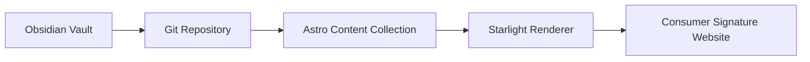

import { MediaAudio, MediaEmbed, MediaFigure, MediaVideo } from '@gaga/engine-astro';

> [!IMPORTANT]
> Dokumen ini adalah **fixture QA**, bukan artikel produksi. Biarkan seluruh elemen tetap ada agar perubahan tema, CSS, shell, dan runtime Consumer Signature dapat diuji secara konsisten.

## Ringkasan pengujian

Halaman ini menguji:

- hierarki heading;
- paragraf panjang dan pendek;
- **bold**, *italic*, ***bold italic***, ~~strikethrough~~, dan `inline code`;
- tautan internal, eksternal, dan anchor;
- blockquote dan callout Obsidian;
- asides bawaan Starlight;
- ordered list, unordered list, nested list, dan task list;
- tabel lebar;
- gambar, caption, audio, video, dan iframe;
- code block, filename, line highlight, diff, dan terminal output;
- `<details>`, `<kbd>`, `<mark>`, `<abbr>`, `<sub>`, `<sup>`, dan `<hr>`;
- footnote, definisi istilah, serta teks campuran Indonesia–English.

---

## 1. Tipografi dan paragraf

Ini paragraf biasa untuk menguji ukuran font, line-height, lebar kolom baca, kontras, dan jarak antarparagraf. Consumer Signature menggunakan pengalaman membaca yang tenang, tetapi antarmukanya tetap terasa responsif seperti sebuah console blueprint yang hidup.

Paragraf kedua memuat **teks tebal**, *teks miring*, ***teks tebal dan miring***, ~~teks dicoret~~, `const inlineCode = true`, simbol © ® ™, pecahan ½, tanda em dash —, ellipsis…, dan emoji terbatas: 🧭 🧩 ✅.

Tautan pengujian:

- [Anchor ke tabel](#6-tabel-responsif)
- [Anchor ke kode](#8-expressive-code-dan-code-block)
- [Consumer Signature](https://example.com)
- [hello@example.com](mailto:hello@example.com)

Istilah singkat: <abbr title="Single Source of Truth">SSOT</abbr>, H<sub>2</sub>O, E = mc<sup>2</sup>, tekan <kbd>⌘</kbd> + <kbd>K</kbd>, lalu tandai <mark>teks penting</mark>.

## 2. Hierarki heading

### Heading level 3

Teks di bawah heading level 3.

#### Heading level 4

Teks di bawah heading level 4.

##### Heading level 5

Teks di bawah heading level 5.

###### Heading level 6

Teks di bawah heading level 6.

---

## 3. Blockquote dan kutipan

> Arsitektur yang baik tidak hanya terlihat rapi ketika selesai, tetapi juga tetap dapat dipahami ketika sistem berubah.

> Blockquote dapat memiliki beberapa paragraf.
>
> Paragraf kedua menguji jarak vertikal, border, warna latar, dan wrap pada layar kecil.
>
> — Consumer Signature Dummy Content

### Nested blockquote

> Lapisan pertama
>
> > Lapisan kedua
> >
> > > Lapisan ketiga

### Callout Obsidian

> [!NOTE]
> Ini adalah callout Obsidian. Bridge Consumer Signature mengubahnya menjadi aside Starlight saat build, sehingga sumber Markdown dari vault tetap cocok dengan Astro.

> [!WARNING]
> Jangan menghapus callout ini karena pipeline Consumer Signature memakai transformer Obsidian ke Starlight.

## 4. Asides bawaan Starlight

:::note
Ini adalah aside `note` bawaan Starlight.
:::

:::tip[Tip dengan judul khusus]
Gunakan judul khusus untuk memeriksa alignment ikon, wrapping judul, dan spacing isi.
:::

:::caution
Aside ini menguji pesan yang membutuhkan perhatian.
:::

:::danger
Aside `danger` harus tetap terbaca jelas pada light mode, dark mode, dan mode kontras tinggi.
:::

:::note
Aside dapat berisi daftar:

1. Item pertama
2. Item kedua
3. Item ketiga dengan `inline code`
:::

## 4.1 Asides bawaan Obsidian

>[!note] Note
Ini adalah aside `note` bawaan Starlight.

>[!tip] Tip
>Gunakan judul khusus untuk memeriksa alignment ikon, wrapping judul, dan spacing isi.

> [!caution] Caution
Aside ini menguji pesan yang membutuhkan perhatian.

>[!danger] Danger
Aside `danger` harus tetap terbaca jelas pada light mode, dark mode, dan mode kontras tinggi.


>[!note]
Aside dapat berisi daftar:
> 1. Item pertama
> 2. Item kedua
> 3. Item ketiga dengan `inline code`

## 5. Daftar

### Unordered list

- Item utama pertama
- Item utama kedua
  - Anak item A
  - Anak item B
    - Cucu item B.1
    - Cucu item B.2
- Item utama ketiga

### Ordered list

1. Tulis artikel di Obsidian.
2. Commit Markdown ke Git.
3. Jalankan build Astro.
4. Periksa output Starlight.
5. Jalankan acceptance test.

### Task list

- [x] Frontmatter terbaca
- [x] Heading tampil
- [x] Aside tampil
- [ ] Gambar lokal tersedia
- [ ] Audio dan video diuji pada perangkat nyata
- [ ] Tabel diuji pada viewport sempit

### Definition-style list

**Canonical source**
Obsidian Vault atau Markdown di Git.

**Renderer**
Astro + Starlight.

**Editor masa depan**
Consumer Signature Studio sebagai editor Markdown berbasis Git, bukan CMS/database kedua.

## 6. Tabel responsif

| Status | Komponen | Tujuan Uji          | Desktop | Mobile | Catatan Panjang                                                               |
| :----: | -------- | ------------------- | :-----: | :----: | ----------------------------------------------------------------------------- |
|   ✅    | Heading  | Hierarki tipografi  |  Pass   |  Pass  | Pastikan anchor tidak tertutup sticky header.                                 |
|   ✅    | Aside    | Kontras dan spacing |  Pass   |  Pass  | Judul panjang harus membungkus tanpa menabrak ikon.                           |
|   ⚠️   | Table    | Overflow horizontal |  Check  | Check  | Tabel ini sengaja lebar untuk memeriksa scroll container pada viewport kecil. |
|   ⚠️   | Image    | Aspect ratio        |  Check  | Check  | Gambar tidak boleh menyebabkan layout shift berlebihan.                       |
|   ⚠️   | Code     | Horizontal scroll   |  Check  | Check  | Baris panjang harus dapat digeser tanpa memotong isi halaman.                 |
|   ⚠️   | Media    | Native controls     |  Check  | Check  | Audio/video harus tetap dapat dioperasikan dengan keyboard.                   |

## 7. Gambar dan figur

### Gambar Markdown lokal


*Teks miring ini berfungsi sebagai caption sederhana di bawah gambar Markdown.*

### Figure dengan caption semantik

<MediaFigure
  src="/images/tests/starlight-rich-media-test.svg"
  alt="Diagram placeholder blueprint Consumer Signature dengan grid, panel, dan label rich media test"
  width="1200"
  height="675"
  caption="Figure 1 - Placeholder lokal untuk menguji ukuran intrinsik, lazy loading, alt text, dan caption."
/>

<MediaFigure
  src="/images/tests/starlight-rich-media-test.svg"
  decorative
  width="1200"
  height="675"
  caption="Figure dekoratif - contoh gambar yang sengaja memakai alt kosong melalui kontrak utility."
/>

### Gambar eksternal opsional


> Apabila kebijakan CSP atau privacy Consumer Signature memblokir domain eksternal, gambar di atas boleh gagal. Kegagalan tersebut justru berguna untuk menguji fallback dan console warning.

## 8. Expressive Code dan code block

### JavaScript dengan filename dan highlight

```js title="src/scripts/rich-media-test.js" {4-8} showLineNumbers
const state = {
  theme: "blueprint",
  sfx: true,
  readerMode: "focused",
};

export function bootRichMediaTest() {
  document.documentElement.dataset.richMediaTest = "ready";
  console.info("[Consumer Signature] Rich media fixture ready", state);
}
```

### TypeScript dengan diff markers

```ts title="src/lib/content-contract.ts"
type ContentSource = "obsidian-git" | "cms";

- const source: ContentSource = "cms";
+ const source: ContentSource = "obsidian-git";

export const contentContract = {
  source,
  editor: "Consumer Signature Studio",
  database: false,
};
```

### Astro component example

```astro title="src/components/TestPanel.astro"
---
interface Props {
  title: string;
  status?: "pass" | "check" | "fail";
}

const { title, status = "check" } = Astro.props;
---

<section class="test-panel" data-status={status}>
  <h2>{title}</h2>
  <slot />
</section>
```

### CSS dengan baris panjang

```css title="src/styles/rich-media-test.css" showLineNumbers
.rich-media-test {
  container-type: inline-size;
  display: grid;
  grid-template-columns: minmax(0, 1fr);
  gap: clamp(1rem, 2vw, 2rem);
}

.rich-media-test :where(img, video, iframe, table, pre) {
  max-inline-size: 100%;
}

@container (width < 42rem) {
  .rich-media-test {
    --pakrpp-test-density: compact;
  }
}
```

### JSON

```json title="content-test-result.json"
{
  "route": "/test/rich-media/",
  "renderer": "starlight",
  "source": "obsidian-markdown",
  "checks": {
    "typography": true,
    "asides": true,
    "tables": true,
    "code": true,
    "media": true
  }
}
```

### Terminal

```bash title="Terminal"
npm run dev
npm run build
npm run verify
```

```text title="Expected output"
✓ Content collection loaded
✓ Rich media test route generated
✓ Starlight asides rendered
✓ Expressive Code rendered
```

### Baris sangat panjang

```text
Ini adalah satu baris yang sengaja dibuat sangat panjang untuk menguji horizontal overflow pada code block tanpa memaksa seluruh layout halaman melebar melebihi viewport perangkat.
```

## 9. Details, disclosure, dan HTML ringan

<details>
  <summary>Buka panel detail</summary>

  Isi panel ini menguji elemen disclosure native. Fokus keyboard, indikator terbuka, animasi, dan spacing harus tetap jelas.

  - Detail item pertama
  - Detail item kedua
  - Detail item ketiga
</details>

<details open>
  <summary>Panel yang terbuka secara default</summary>

  Panel ini sengaja menggunakan atribut `open`.
</details>

<div role="group" aria-label="Status pengujian">
  <p><strong>Status:</strong> <span data-test-status="ready">Ready for QA</span></p>
</div>

## 10. Audio

<MediaAudio
  sources={[
    {
      src: 'https://interactive-examples.mdn.mozilla.net/media/cc0-audio/t-rex-roar.mp3',
      type: 'audio/mpeg'
    }
  ]}
  caption="Audio eksternal MDN untuk memvalidasi native controls, fallback, dan caption semantik."
  fallback={{
    text: 'Browser Anda tidak mendukung elemen audio.',
    href: 'https://interactive-examples.mdn.mozilla.net/media/cc0-audio/t-rex-roar.mp3'
  }}
/>

:::caution
Audio di atas berasal dari aset contoh eksternal MDN. Untuk pengujian produksi, salin aset ke `public/media/tests/` dan gunakan URL lokal.
:::
>[!caution]
>Audio di atas berasal dari aset contoh eksternal MDN. Untuk pengujian produksi, salin aset ke `public/media/tests/` dan gunakan URL lokal.
## 11. Video

<MediaVideo
  sources={[
    {
      src: 'https://interactive-examples.mdn.mozilla.net/media/cc0-videos/flower.mp4',
      type: 'video/mp4'
    }
  ]}
  poster="/images/tests/starlight-rich-media-test.svg"
  width="1280"
  height="720"
  caption="Video eksternal MDN untuk memvalidasi controls, poster, fallback, dan ukuran intrinsik."
  fallback={{
    text: 'Browser Anda tidak mendukung elemen video.',
    href: 'https://interactive-examples.mdn.mozilla.net/media/cc0-videos/flower.mp4'
  }}
/>

## 12. Iframe responsif

<MediaEmbed
  title="Consumer Signature website preview"
  src="https://example.com"
  width="1280"
  height="720"
  sandbox="allow-scripts allow-same-origin"
  privacy="first-party"
  caption="Embed eksternal untuk memvalidasi title, sandbox, privacy marker, dan fallback."
  fallback={{
    text: 'Consumer Signature website preview',
    href: 'https://example.com'
  }}
/>

:::note
Sebagian website menolak iframe melalui `X-Frame-Options` atau CSP `frame-ancestors`. Apabila preview gagal, periksa apakah fallback, tinggi container, dan pesan browser tetap tidak merusak layout.
:::

>[!note] Note
> Sebagian website menolak iframe melalui `X-Frame-Options` atau CSP `frame-ancestors`. Apabila preview gagal, periksa apakah fallback, tinggi container, dan pesan browser tetap tidak merusak layout.

## 13. Link card versi Markdown

### [Buka dokumentasi Consumer Signature →](https://example.com)

Ringkasan pendek yang meniru pola kartu tautan tanpa membutuhkan komponen MDX. Gunakan bagian ini untuk menguji hover, focus-visible, dan visited state.

### [Kirim pesan WhatsApp →](https://wa.me/628899456754)

Kontak publik Consumer Signature untuk menguji tautan eksternal dan perilaku pada perangkat mobile.

## 14. Footnote

Consumer Signature menggunakan Obsidian/Markdown di Git sebagai sumber konten kanonis.[^canonical] Pendekatan ini menjaga artikel tetap portabel dan mudah diaudit.[^portable]

[^canonical]: Sumber kanonis berarti perubahan utama dilakukan pada Markdown, bukan disalin ke database CMS kedua.
[^portable]: Portabel berarti konten masih dapat dibaca, dicari, di-version-control, dan dipindahkan tanpa bergantung pada editor tertentu.

## 15. Karakter, bahasa, dan wrapping

Bahasa Indonesia: “Pengalaman membaca harus tenang, jelas, dan dapat diaudit.”

English: “The interface should feel responsive, layered, mechanical, and alive.”

Jawa: “Alon-alon waton kelakon,” digunakan di sini hanya sebagai sampel teks.

Teks tanpa spasi untuk menguji overflow:

`pakrpp-rich-media-test-abcdefghijklmnopqrstuvwxyz-0123456789-abcdefghijklmnopqrstuvwxyz-0123456789`

URL panjang:

[https://example.com/test/rich-media/sangat-panjang/untuk-menguji/wrapping-dan-overflow-pada-layout-starlight-di-perangkat-mobile](https://example.com/test/rich-media/sangat-panjang/untuk-menguji/wrapping-dan-overflow-pada-layout-starlight-di-perangkat-mobile)

## 16. Mermaid sebagai fallback code fence

Blok berikut akan tampil sebagai code block biasa apabila integrasi Mermaid belum dipasang.



## 17. Rumus sebagai teks

Tanpa plugin matematika, ekspresi berikut tetap terbaca sebagai teks biasa:

- Inline: `E = mc²`
- Display: `F(x) = ∫₀ˣ f(t) dt`
- Statistik: `z = (x - μ) / σ`

> Tambahkan integrasi remark/rehype matematika hanya apabila memang menjadi kebutuhan konten Consumer Signature. Jangan menjadikan fixture ini alasan untuk menambah dependency produksi.

## 18. Empty state dan separator

---

<div aria-label="Empty state test">
  <p><strong>Belum ada catatan tersimpan.</strong></p>
  <p>Simpan halaman ini untuk menguji state reader preferences dan saved reading.</p>
</div>

---

## 19. Checklist QA manual

- [ ] Frontmatter tidak memicu schema error.
- [ ] Sidebar label dan order terbaca.
- [ ] Semua heading memiliki anchor yang stabil.
- [ ] Table of contents menampilkan hierarki yang benar.
- [ ] Asides Starlight memiliki ikon, warna, dan kontras yang benar.
- [ ] Callout Obsidian tidak merusak blockquote.
- [ ] Tabel dapat digeser pada viewport sempit.
- [ ] Code block tidak memperlebar layout.
- [ ] Tombol copy code dapat dioperasikan.
- [ ] Gambar lokal tidak mengalami layout shift.
- [ ] Alt text tersedia.
- [ ] Audio dan video dapat dioperasikan dengan keyboard.
- [ ] Iframe gagal dengan aman apabila diblokir.
- [ ] Focus-visible terlihat.
- [ ] Light mode dan dark mode lulus pemeriksaan visual.
- [ ] Print stylesheet tetap terbaca.
- [ ] Pagefind menemukan istilah “canonical source”.
- [ ] Reader preferences tidak menghilangkan elemen media.
- [ ] SFX tidak berbunyi saat sekadar scroll.
- [ ] Tidak ada error atau warning baru yang tidak dijelaskan di console.

## 20. Penutup

:::tip[Fixture selesai]
Apabila seluruh bagian halaman ini dapat dirender, dibaca, dinavigasi dengan keyboard, dan tetap stabil di mobile maupun desktop, kontrak rich media dasar Consumer Signature dapat dianggap lulus pemeriksaan awal.
:::

> [!tip] Fixture selesai
Apabila seluruh bagian halaman ini dapat dirender, dibaca, dinavigasi dengan keyboard, dan tetap stabil di mobile maupun desktop, kontrak rich media dasar Consumer Signature dapat dianggap lulus pemeriksaan awal.
